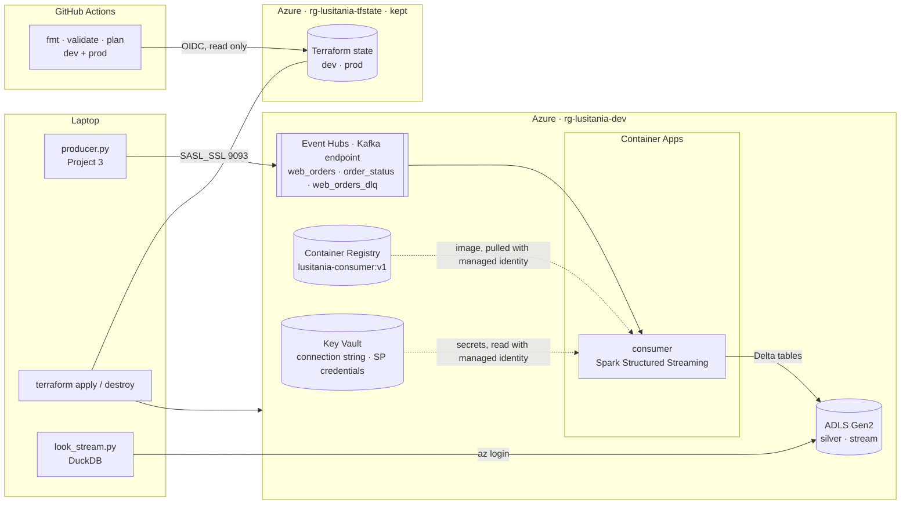

# Lusitânia Stores — Azure with Terraform

Project 4 of the Lusitânia data-engineering portfolio. The streaming pipeline of [Project 3](https://github.com/JNFernandes/lusitania-pipelines) runs here on Azure, with every resource created and destroyed by Terraform:

- **Event Hubs** replaces the local Kafka. The producer and the consumer don't change, because Event Hubs speaks the Kafka protocol.
- **ADLS Gen2** replaces the laptop folder. Spark writes the live Delta tables to `abfss://` paths.
- **Azure Container Apps** runs the Spark consumer from an image in the **Azure Container Registry**.
- **Key Vault** holds every secret, and **managed identities** read them, so no password or storage key is in the code, in a file or in Git.
- **GitHub Actions** checks every push and runs `terraform plan` for dev and prod, logging in to Azure with **OIDC** (no stored secret).

It runs on an Azure Free Trial: the dev environment is created for a session and destroyed every evening, and only the Terraform state is kept.

<p>
  
  
  
  
  
  
</p>

---

## Architecture



| Module | Creates | Notes |
|---|---|---|
| `keyvault` | Key Vault with RBAC authorization, your *Secrets Officer* role | waits 90 s (`time_sleep`) so the role is active before secrets are written |
| `identity` | a user-assigned **managed identity** and a **service principal** (`azuread`), its client secret stored in Key Vault | the managed identity reads secrets and pulls the image; Spark logs in to the lake as the service principal, so the same code works in Docker on the laptop and in Azure |
| `lake` | ADLS Gen2 storage account (hierarchical namespace), containers `bronze`, `silver`, `gold`, `stream`, *Blob Data Contributor* roles | shared keys **disabled**: only Entra ID logins work |
| `eventhubs` | Standard namespace, three event hubs (3 / 3 / 1 partitions), a listen + send rule, its connection string in Key Vault | the Kafka endpoint needs Standard tier |
| `consumer_app` | Container Registry (admin user off), *AcrPull* for the identity, Container Apps environment and app (2 CPU, 4 GiB, 1 replica) | secrets are Key Vault **references**: the app reads them at start, nothing is copied |

The app and its environment exist only when `deploy_consumer = true`. The registry has to exist first, so the image can be pushed before the app that runs it is created.

---

## Two environments, one code

`envs/dev` and `envs/prod` have the **same** `main.tf` and call the same modules. Only `env.auto.tfvars` differs:

| | dev | prod |
|---|---|---|
| budget alert | €1 | €50 |
| lake replication | LRS | GRS |
| Event Hubs throughput units | 1 | 2 |
| Event Hubs retention | 1 day | 7 days |
| state file | `lusitania-dev.tfstate` | `lusitania-prod.tfstate` |
| used for | apply, test, destroy every evening | `terraform plan` only (never applied on the trial) |

The state lives in its own storage account (`scripts/bootstrap_state.ps1`), outside both environments, so `terraform destroy` never deletes it. It's versioned, Terraform logs in to it with Entra ID instead of a key, and a blob lease locks it while a plan or apply runs.

---

## Security: where each secret lives

| What | Where | Who can read it |
|---|---|---|
| Event Hubs connection string | Key Vault, written by Terraform | the consumer's managed identity, you |
| Service principal secret (Spark → lake) | Key Vault, written by Terraform | the consumer's managed identity, you |
| Storage account keys | nowhere useful: shared keys are disabled, so the keys are rejected | — |
| Image pull | no password: the registry's admin user is off; the managed identity has *AcrPull* | — |
| CI login to Azure | no secret: GitHub's OIDC token, trusted for this repo's `main` and pull requests only | — |
| Subscription id, e-mail | `terraform.tfvars` (not in Git); in CI, a GitHub variable and a secret | — |

On the laptop, `streaming/cloud_env.ps1` in Project 3 reads the secrets from Key Vault into the current PowerShell window only. Close the window and they're gone.

> The state still contains secret values (the client secret, the connection string, even the disabled storage keys), so it's never committed and stays in a private storage account.

---

## CI: GitHub Actions with OIDC

`.github/workflows/terraform.yml` runs on every push to `main` and every pull request:

1. **fmt + validate**, without Azure: `terraform fmt -check`, and `init -backend=false` + `validate` for dev and prod.
2. **plan dev** and **plan prod**, with the real state: the summary of each plan is shown on the run page.

Nothing is applied from CI. Applying stays a deliberate step on the laptop.

**How the login works:** GitHub gives the workflow a short-lived token that says which repo and branch it is. Entra ID has two **federated credentials** for `sp-lusitania-github-ci` (`scripts/bootstrap_ci.ps1`). They trust GitHub's tokens only when the subject matches:

```
repo:JNFernandes@<owner id>/lusitania-azure@<repo id>:ref:refs/heads/main
repo:JNFernandes@<owner id>/lusitania-azure@<repo id>:pull_request
```

That identity has *Reader* on the subscription and *Blob Data Contributor* on the state account, which is enough to plan but not to change anything.

---

## Results

The full cloud path, on one session: producer on the laptop → Event Hubs → consumer in Container Apps → Delta tables on ADLS Gen2.

| Check (`look_stream.py`, reading the cloud tables) | Result |
|---|---|
| orders sent → orders in the live table | **238 / 238** |
| the same event written twice | **0** |
| an order number reused | **0** |

Then `terraform destroy` removed everything except the state account.

---

## Lessons learned

| Problem | Cause | Fix |
|---|---|---|
| `az acr build` fails with `TasksOperationsNotAllowed` | ACR Tasks are blocked on Free Trial subscriptions | build with Docker on the laptop and `docker push` (`build_consumer_image.ps1` in Project 3) |
| Container App fails with `MissingSubscriptionRegistration` | the subscription had never used `Microsoft.App` | `resource_providers_to_register = ["Microsoft.App"]` in the provider |
| Writing a secret right after creating the vault fails with 403 | a new role assignment takes a minute or two to work | `time_sleep` after the role, and the module's output depends on it |
| Container App created, but the apply failed with a 412 reading its secrets, and Terraform marked it *tainted* (to be replaced) | Azure answered with an error although the app was fine | `terraform untaint` instead of letting Terraform recreate it |
| `terraform destroy` + `apply` fails because the vault name is taken | Key Vault keeps deleted vaults for 7 days (soft delete) | `purge_soft_delete_on_destroy = true` |
| Budget changes on every plan | its start date is computed from today | `lifecycle { ignore_changes = [time_period] }` |
| The producer can't send with compression | Event Hubs' Kafka endpoint (Standard) doesn't accept compressed batches | compression off in cloud mode (Project 3's `eventhubs.py`) |
| Storage keys appear in the state although they're disabled | Azure still generates them; it just rejects them | treat the state as secret anyway |
| A script prints "Done" after `az` failed | PowerShell doesn't stop when an external command fails | check `$LASTEXITCODE` after each `az` call |
| CI login fails with `AADSTS700213` | GitHub's OIDC subject now includes the account and repo ids | federated credentials with `owner@id/repo@id` (built from GitHub's API in `bootstrap_ci.ps1`) |

---

## Repository structure

```
LusitaniaAzure/
├── .github/workflows/terraform.yml   CI: fmt, validate, plan dev + prod (OIDC)
├── envs/
│   ├── dev/                          main.tf, variables.tf, outputs.tf, versions.tf (backend), env.auto.tfvars
│   └── prod/                         the same, with prod sizes
├── modules/
│   ├── keyvault/   identity/   lake/   eventhubs/   consumer_app/
├── scripts/
│   ├── bootstrap_state.ps1           once: the state storage account
│   ├── bootstrap_ci.ps1              once: the CI identity and its federated credentials
│   ├── upload_reference.ps1          silver products and exchange rates → the cloud lake
│   ├── read_lake.py                  read a Delta table in the lake with DuckDB
│   └── read_secret.py                read a Key Vault secret with DefaultAzureCredential
└── requirements.txt                  for the scripts
```

---

## How to run

**Prerequisites:** an Azure subscription, the Azure CLI, Terraform 1.17, Docker Desktop, and [Project 2](https://github.com/JNFernandes/lusitania-lakehouse) and [Project 3](https://github.com/JNFernandes/lusitania-pipelines) cloned next to this folder.

```powershell
# Once
az login
.\scripts\bootstrap_state.ps1
Copy-Item envs\dev\terraform.tfvars.example envs\dev\terraform.tfvars   # subscription id, e-mail

# Each session: infrastructure, without the consumer app
cd envs\dev
terraform init
terraform apply
cd ..\..
.\scripts\upload_reference.ps1

# The consumer: push its image, then create the app
cd ..\LusitaniaPipelines
.\cloud\build_consumer_image.ps1 -Registry acrlusitaniadevjf01 -Tag v1
cd ..\LusitaniaAzure\envs\dev
terraform apply -var deploy_consumer=true

# Send orders and look at the cloud tables (Project 2's venv)
cd ..\..\..\LusitaniaPipelines
. .\streaming\cloud_env.ps1
python streaming\producer.py --rate 2 --duration 120
python streaming\look_stream.py

# End of the day
. .\streaming\cloud_env.ps1 -Off
cd ..\LusitaniaAzure\envs\dev
terraform destroy
```

**CI, once:** `.\scripts\bootstrap_ci.ps1 -Repo <owner>/<repo>`, then in GitHub, under *Settings → Secrets and variables → Actions*: the variables `AZURE_CLIENT_ID`, `AZURE_TENANT_ID`, `AZURE_SUBSCRIPTION_ID` and the secret `TF_VAR_ALERT_EMAIL`.

---

## Concepts in this project

| Terraform | Azure | Security |
|---|---|---|
| provider, resource, data source | resource group, region, tags | control plane vs data plane (RBAC) |
| variables, locals, outputs | ADLS Gen2, hierarchical namespace, `abfss://` | managed identity, `DefaultAzureCredential` |
| state, remote backend, locking | Event Hubs: Kafka endpoint, throughput units | service principal, client secret |
| bootstrap, `init -migrate-state` | Container Registry, Container Apps | Key Vault references |
| modules, environments | resource provider registration | shared keys disabled |
| `for_each`, `count`, `dynamic` | Key Vault soft delete and purge | OIDC federated credentials |
| `lifecycle`, `time_sleep`, taint | budgets and cost alerts | least privilege for CI |
